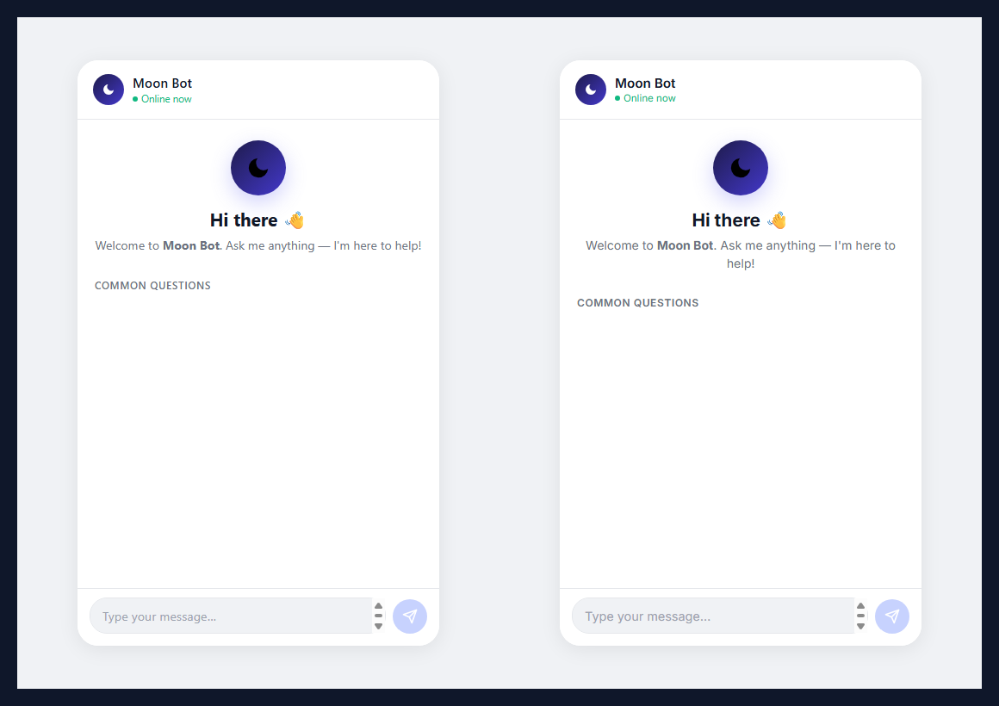
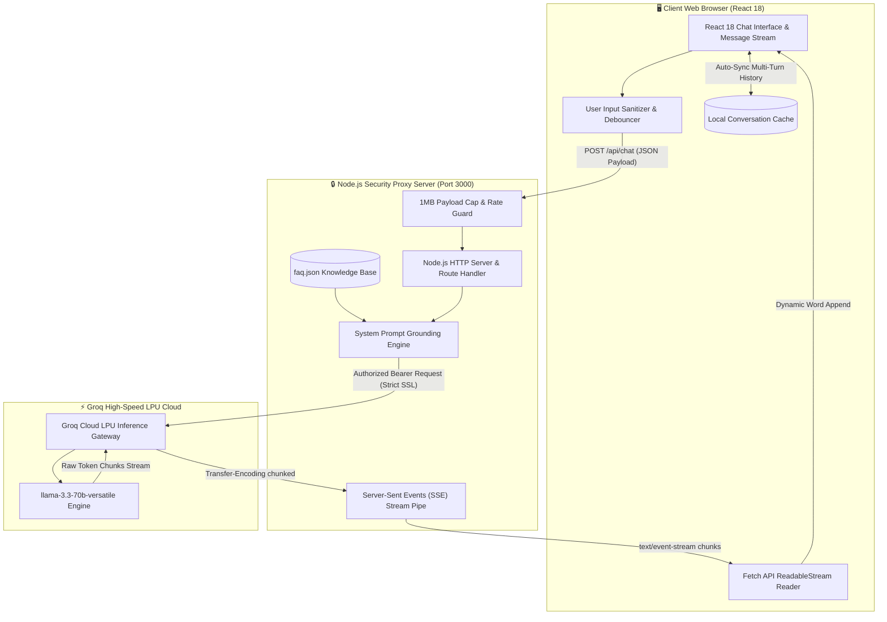

# 🌙 Moon Bot — Enterprise AI Customer Support Platform

<div align="center">

### **Zero-Secret-Leak Security Proxy, Sub-200ms Token Streaming via Server-Sent Events (SSE), Grounded Corporate Knowledge Injection & WhatsApp-Inspired Interface**

[](https://react.dev/)
[](https://nodejs.org/)
[](https://groq.com/)
[](https://groq.com/)
[]()
[](LICENSE)

<br/>

Architected & Engineered by **[Obaidhur Rahaman](https://rahaman1721.framer.website)** · Full Stack Developer & UI/UX Designer  
*Bridging high-speed neural language processing with deterministic domain grounding and zero-trust security architecture.*

<br/>



*Figure 1: Authentic Moon Bot interface showcasing the Welcome & FAQ screen (left) alongside the live streaming conversational chat with markdown formatting and grounded support policies (right).*

</div>

---

## 1. Project Title, Badges & Vision

### 🛡️ The Vision: Fast, Grounded, and Zero-Leak AI Customer Support
Integrating Large Language Models directly into client-side browser single-page applications exposes critical production vulnerabilities:
1. **Compromised API Credentials:** Client-side keys (`VITE_OPENAI_API_KEY`, `VITE_GROQ_API_KEY`) can be extracted from browser network tabs and decompiled bundles within seconds.
2. **Hallucination Risk:** Ungrounded LLMs invent imaginary return policies, unauthorized discounts, and inaccurate delivery timelines.
3. **High Chat Latency:** Traditional non-streaming REST endpoints force customers to wait 5–10 seconds before seeing a single word of assistance.

**Moon Bot** resolves all three challenges through a **Zero-Trust Node.js Proxy Server** delivering **real-time token streaming via Server-Sent Events (SSE)** powered by Groq's high-speed LPU inference engine. The LLM is strictly constrained to approved organizational FAQs with sub-200ms time-to-first-token (TTFT) response velocity.

---

## 2. Exhaustive Module & Feature Breakdown

### 🔒 Module A: Zero-Trust Security Proxy Architecture
- **Complete Credential Shielding**: The client bundle contains zero references to `GROQ_API_KEY`. The browser communicates exclusively with the local proxy server (`/api/chat`).
- **Input Sanitization & Buffer Protection**: Rejects payloads exceeding 1MB to prevent memory exhaustion and denial-of-service (DoS) attacks.
- **CORS & Origin Isolation**: Configured to restrict POST requests strictly to authorized client domains.
- **Fail-Safe Offline Graceful Degrade**: If the LLM provider experiences an outage, the proxy gracefully falls back to structured offline contact directives (`support@northline.example`).

### 📚 Module B: Deterministic Domain Knowledge Grounding
- **JSON Knowledge Injection (`faq.json`)**: Loads vetted company policies spanning order tracking, 14-day return rules, delivery windows, payment methods, and password recovery.
- **Dynamic System Prompt Engineering**: Injects structured Q&A pairs directly into the LLaMA 3.3 system prompt context.
- **Hallucination Constraint**: Strict behavioral directives (*"Answer using only the support information below. Never invent policies, prices, or timelines. If the customer is upset, acknowledge it in one sentence before helping."*).

### ⚡ Module C: Sub-200ms Streaming Engine (Server-Sent Events)
- **HTTP Chunked Transfer Encoding**: Establishes a persistent `text/event-stream` socket connection via native Node.js HTTP pipes.
- **Real-Time Token Append**: Tokens stream to the client browser with sub-200ms latency, creating a live, fluid typing animation.
- **Fetch ReadableStream Consumption**: The frontend consumes raw binary chunks using the browser's native `TextDecoder` and `ReadableStreamDefaultReader`.

### 🎨 Module D: Modern Chat Interface & Micro-Interactions
- **WhatsApp/ChatGPT-Inspired Aesthetics**: High-contrast dark theme with distinct conversational bubble alignments (User vs. Moon Bot).
- **Animated Typing Indicator**: Visual three-dot pulse animation signaling active server processing before the first token stream begins.
- **Smart Auto-Scroll & Viewport Anchoring**: Automatically scrolls to the newest message during token streaming, intelligently pausing if the user scrolls up to read earlier history.
- **Quick-Reply Prompt Chips**: Pre-configured conversational shortcut pills (e.g., "Track Order", "Return Policy", "Delivery Times").

### 💾 Module E: Multi-Turn Conversation Memory
- **Client-Side Enclave Cache**: Conversations automatically persist to browser `localStorage` across page refreshes.
- **Multi-Turn Context Preservation**: Dispatches previous dialogue history within the API payload, allowing the LLM to understand contextual follow-up questions.
- **1-Click Conversation Reset**: Clears active session history and restores initial welcome greeting state.

---

## 3. System Architecture & Tech Stack



| Layer | Technologies | Architectural Function |
|:---|:---|:---|
| **Frontend Framework** | React 18, Vite, Modern ES6+ | Lightweight, reactive chat interface with fast DOM updates. |
| **Backend & Proxy** | Node.js (Built-in HTTP / Express) | Static asset server + secure LLM streaming reverse proxy. |
| **AI Inference Engine** | Groq Cloud LPU | Ultra-low latency tensor computing running `llama-3.3-70b-versatile`. |
| **Data & Grounding** | `faq.json` (Local Knowledge Base) | Deterministic corporate policies injected into system prompts. |
| **Styling & Design Tokens** | CSS3 Custom Properties, Flexbox | Clean responsive layout with dark mode contrast and mobile responsiveness. |

---

## 4. Complete Folder Structure

```
ai-customer-support-chatbot/
├── dist/                                 # Compiled production web bundle (Static Assets)
├── src/                                  # React 18 Application Source Code
│   ├── App.jsx                           # Primary chat workspace, streaming hooks, and event handlers
│   ├── main.jsx                          # React 18 DOM bootstrap
│   └── styles.css                        # Modern CSS tokens, animated typing dots & dark theme
├── .env.example                          # Environment template (Placeholders for GROQ_API_KEY & PORT)
├── .gitignore                            # Excludes real .env, node_modules, and build caches
├── faq.json                              # Organizational knowledge base (Grounding source)
├── index.html                            # Application HTML5 shell with viewport metadata
├── package.json                          # Dependencies & NPM build scripts
├── server.js                             # Zero-trust Node.js HTTP reverse proxy & SSE pipeline
└── vite.config.js                        # Vite bundler configuration
```

---

## 5. Screen / Route & API Inventory

### Application Screen & View Inventory

| View Component | Route | Primary Purpose |
|:---|:---|:---|
| `App.jsx` | `/` (Single Page App) | Full customer support interface: message log, quick replies, active typing indicator, and input bar. |

### API Endpoint Inventory (`server.js`)

| Endpoint | Method | Payload / Headers | Response & Function |
|:---|:---|:---|:---|
| `/api/chat` | `POST` | `Content-Type: application/json`<br/>`{ messages: [...] }` | **SSE Streaming Response** (`text/event-stream`). Grounded system prompt + Groq token stream. |
| `/api/health` | `GET` | None | Returns `200 OK` health status for container monitoring. |
| `/*` | `GET` | Static file requests | Serves compiled HTML, JS, CSS, and SVG assets from `/dist`. |

---

## 6. Getting Started (Local Setup & Installation)

### Prerequisites
- **Node.js**: v18.0.0 or higher (v20+ recommended).
- **Groq API Key**: Obtain a free API key from **[console.groq.com](https://console.groq.com)**.

### 1. Clone Repository
```bash
git clone https://github.com/rahaman1721/ai-customer-support-chatbot.git
cd ai-customer-support-chatbot
```

### 2. Install Dependencies
```bash
npm install
```

### 3. Configure Environment Variables
Create a `.env` file in the project root:
```env
GROQ_API_KEY=your_actual_groq_api_key_here
GROQ_MODEL=llama-3.3-70b-versatile
PORT=3000
```

### 4. Build & Launch Server
```bash
# 1. Compile production frontend bundle
npm run build

# 2. Start Node.js security proxy server
node server.js
```

Open **[http://localhost:3000](http://localhost:3000)** in your browser!

---
---

## 👨‍💻 Author

**Obaidhur Rahaman**  
Full Stack Developer & Lead UI/UX Designer  

- 🌐 **Portfolio**: [https://rahaman1721.framer.website](https://rahaman1721.framer.website)  
- 🐙 **GitHub**: [@rahaman1721](https://github.com/rahaman1721)  
- 💼 **LinkedIn**: [linkedin.com/in/obaidhur-rahaman-1721z](https://www.linkedin.com/in/obaidhur-rahaman-1721z)  
- 📧 **Email**: [rahaman171920@gmail.com](mailto:rahaman171920@gmail.com)  

<div align="center">
  <sub>Designed & Developed with precision by Obaidhur Rahaman © 2026</sub>
</div>
