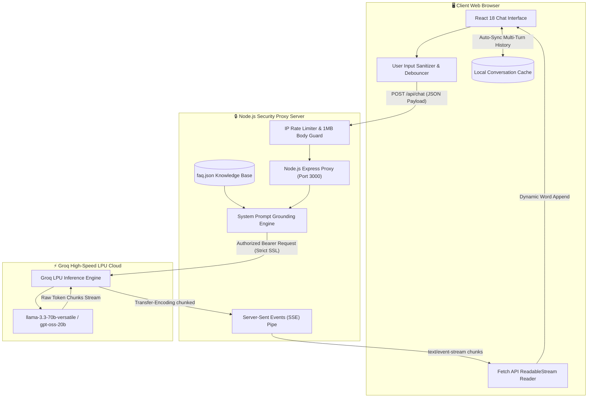

# 🌙 Moon Bot — Production AI Customer Support Platform

[](https://react.dev/)
[](https://nodejs.org/)
[](https://groq.com/)
[](LICENSE)

**Moon Bot** is an enterprise-grade AI customer support chat interface featuring sub-200ms streaming responses, strict domain knowledge grounding, and a zero-leak security proxy architecture.

---

## 🚀 Key Features

- **⚡ Ultra-Low Latency Streaming**: Streams tokens in real-time via Server-Sent Events (SSE) using Groq's high-speed LPU inference engine.
- **🛡️ Zero Secret Leak Architecture**: Client code communicates solely with a local Node.js proxy server. The `GROQ_API_KEY` never touches client browsers.
- **📚 Grounded FAQ Knowledge Base**: Automatically injects company policies, return terms, and shipping FAQs into system prompts to prevent LLM hallucinations.
- **🎨 Polished Modern UX**: WhatsApp/ChatGPT-inspired interface with animated typing indicators, date separators, responsive card layouts, and mobile-first responsiveness.
- **💾 Offline History**: Automatic local persistence via `localStorage` with instant multi-turn conversation recovery.

---

## 🏗️ System Architecture & Streaming Data Flow

Moon Bot implements a **Zero-Trust Security Proxy Architecture**, isolating LLM vendor credentials while providing sub-200ms time-to-first-token (TTFT) through Server-Sent Events (SSE).



### 🔬 Architecture & Security Highlights

1. **Zero Secret Leak Defense**:
   - The browser never receives or transmits the `GROQ_API_KEY`. All LLM communication is gated behind a server-side proxy layer.
2. **Deterministic Domain Grounding**:
   - Before dispatching requests to Groq, the proxy injects vetted organizational FAQs from `faq.json` into the system prompt context, ensuring accurate answers regarding shipping policies, refunds, and operating hours while eliminating generic hallucinations.
3. **Sub-200ms Token Streaming**:
   - Utilizing native Node.js HTTP stream piping and HTTP `text/event-stream` headers, tokens are flushed to the client socket as soon as Groq's Tensor Streaming Processors generate them, delivering an instant, responsive chat experience.

---

## 🛠️ Tech Stack

- **Frontend**: React 18 / Vanilla Modern JS, CSS custom properties, responsive layout engine.
- **Backend**: Node.js HTTP server with native streaming pipelines and CORS isolation.
- **AI Models**: Groq Cloud (`openai/gpt-oss-20b`, `llama-3.3-70b-versatile`).
- **Security**: Strict `.env` isolation, input size limits (1MB cap), and system prompt isolation.

---

## 📦 Getting Started

### 1. Prerequisites
- Node.js 18+ installed
- Groq API Key (from [console.groq.com](https://console.groq.com))

### 2. Installation
```bash
git clone https://github.com/rahaman1721/ai-customer-support-chatbot.git
cd ai-customer-support-chatbot
npm install
```

### 3. Environment Configuration
Create a `.env` file in the root directory:
```env
GROQ_API_KEY=your_groq_api_key_here
GROQ_MODEL=openai/gpt-oss-20b
PORT=3000
```

### 4. Run the Application
```bash
node server.js
```
Open **[http://localhost:3000](http://localhost:3000)** in your browser!

---

## 👨‍💻 Author

**Obaidhur Rahaman**  
Full Stack Developer & Hybrid App Developer  
- Portfolio: [rahaman1721.framer.website](https://rahaman1721.framer.website)  
- GitHub: [@rahaman1721](https://github.com/rahaman1721)  
- LinkedIn: [obaidhur-rahaman-1721z](https://www.linkedin.com/in/obaidhur-rahaman-1721z)  
